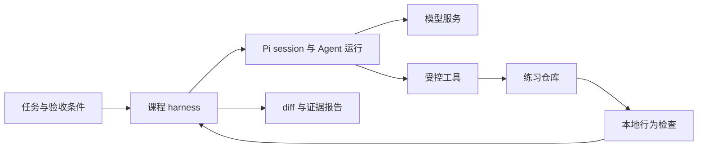

# Pi Agent实战：01 认识 Pi，完成安装与模型连接

本章配套项目：[projects/01-shipping-lab](../../projects/01-shipping-lab/README.md)。从课程目录进入对应项目，后文命令均在该项目根目录执行；相同项目内可以沿用上一章的副本，其他项目的依赖与副本互不共享。

```bash
cd projects/01-shipping-lab
npm ci --ignore-scripts --cache .pi/npm-cache
```

Pi是最近热度超高的AI Agent，用四个字形容就是大道至简。简单来说，Pi（Pi Coding Agent）就是一个专为开发者打造的轻量级本地编码助手，能把大模型变成直接在你本地仓库里敲代码、改文件的“AI打工人”

## 1.1 模型、Agent 和 harness 各管什么

Pi 的角色很简单，就是个架在模型和开发工具之间的桥梁。模型负责动脑筋——提出要读哪个文件、改哪行代码、跑什么命令；Pi 则负责跑腿落地，把执行结果原封不动喂回去。靠着这种你来我往的交互，AI 的修改建议才能真正写进你的源码里。

这里有一个例子：国内订单满 50 元明明说好免运费，结果你下一单刚好卡在 50 元整，结账时运费却一文不少地扣了。规则文档写着“够了”，代码却偏偏说“还差点”。

我们就从这个日常开发里最让人哭笑不得的小 bug 开始：让 Pi 顺藤摸瓜找到运费逻辑，把漏掉的等号补上，然后看看测试能不能高抬贵手。动手前需要一点基础的编程和 Git 手感，连接模型时也得提前把认证方式准备好。

### 从一段回答到一次修改

平时在聊天框里问模型怎么修 bug，它能给你洋洋洒洒解释半天，甚至顺手甩个漂亮的补丁。但只要没人把补丁打进仓库，这个 bug 依然会在原地稳如泰山。

Pi 身上配齐了读取、搜索、命令执行和文本替换的工具。遇到运费函数，模型想看源码，Pi 就去读文件；模型给出修改方案，Pi 照做并把结果带回。如果还没彻底解决，就带着这些新线索继续向模型发问，直到任务收工。

这种把模型、工具和后续迭代连起来的工作流，就是我们常说的 Agent。模型响应一次、顺便触发一堆工具执行，这叫一个 turn（轮次）；修一个 bug 往往得走好几个来回。至于模型能动哪些文件，完全取决于宿主程序和工具给它划定了多少权限——而安全底线，必须死死卡在执行工具的这一层。可以在附录查看[官方运行机制](https://github.com/earendil-works/pi/blob/v1.4.0/packages/coding-agent/docs/how-pi-works.md)

### harness 控制任务的开始与结束

一旦赋予了模型读写文件的特权，事情立马变得“危险”起来：你得给它划定干活的目录、框死允许修改的范围，还得防着它跑太久陷入死循环。万一中途翻车喊停，那些改了一半的烂摊子也得有人收拾。

刚开始上手时，这些琐事全得你亲自盯着、手动检查。等你把这套管理流程用代码固化下来，就成了我们说的 harness。它负责把 Agent 叫醒、等它交工、收走成果，把原本需要你时刻盯梢的苦差事接过去。

把这次修运费的完整流程画出来，差不多是这样：



模型说“改好了”，可不能盲目轻信，验收还得照做。测试用来确认运费算得对不对，diff 用来检查有没有手抖改了不该动的地方。两关全过，成果才算准备好交给人审阅；至于合并、发布和推送，那得另批权限。

`Pi` 既有顺手的交互界面，也支持 `print`、`JSON`、`RPC` 和 `SDK` 等各种入口。前几章咱们老老实实从交互界面开始，等以后想把它揉进自己的程序里，再按需挑选接口。可以查看附录的[集成选型](https://github.com/earendil-works/pi/blob/v1.4.0/packages/coding-agent/docs/cli-integration.md)

### 用任务契约写清边界

嘴里一句“去把运费修了”虽然直白，但它根本不知道自己能动哪些文件、怎么才算过关。把这些规矩落成文字，就是所谓的任务契约。

下面这份 JSON 是教程自己定义的业务数据，跟 Pi 的内置 API 可没关系。到了第 04 章，咱们全靠它来做自动化评测：

```json
{
  "taskId": "shipping-boundary-01",
  "goal": "修正国内订单恰好5000分时的免邮边界",
  "workspace": ".pi/labs/shipping",
  "allowedChanges": ["src/shipping.ts"],
  "requiredValidation": ["npm run lab:check"],
  "delivery": ["diff", "validation", "unverified"],
  "allowCommit": false,
  "allowPush": false
}
```

`goal` 交代要修的是恰好 5000 分的边界，`allowedChanges` 把手脚死死绑在 `src/shipping.ts` 上，`requiredValidation` 写明了从本章项目根目录运行什么检查。`delivery` 则要求它交出 diff、验证结果以及还没验证的部分。

`allowCommit` 和 `allowPush` 都是 `false`，意思很明白：不准擅自提交，更不准乱推代码。不过话说回来，光把要求写进 JSON 里只是填好了工单；要真正拦住这些出格操作，还得靠执行代码去落实。

说回这次的运费修复，教程里的金额统一用整数分表示。国内普通订单 4999 分收 500 分运费，5000 分和 5001 分免基础费；国际加急是 2000 加 800，共 2800 分。

报告里也别藏着掖着，那些难看的失败命令、漏掉的检查，以及取消任务留下的辣手残局，都得一并记录在案。漏掉这些，接手的人就得重新瞎猜。咱现在先练好单用户、单根任务的基本功，第 11 章才会用到基础子 Agent。

所有的练习都在教程提供的受控仓库里折腾。`cwd` 告诉 Pi 去哪里发现资源、让工具默认在哪里干活，休想跳出沙箱的围墙。`project trust` 则决定要不要加载项目资源；工具实际能访问什么，终究还是取决于启动 Pi 的那个操作系统账户有多大权限。可以查看附录的[官方安全边界](https://github.com/earendil-works/pi/blob/v1.4.0/packages/coding-agent/docs/security.md)

## 1.2 安装 Pi，连通模型

第一次上手，别急着让它去翻仓库。先发一句简单的问答，把安装、认证、模型服务这三条线全试通了再说；否则一上来就让它去修代码，真报了错，你都不知道是哪一个环节没接对。

准备好 Node、npm，以及你有权使用的模型认证方式。本教程锁死在 Pi 1.4.0，要求 Node >=22.19.0；写这篇教程时用的本地环境是 Node 26.12.1，时间是 2026-10-24。要求可以查看附录的[包配置](https://github.com/earendil-works/pi/blob/v1.4.0/packages/coding-agent/package.json)、[安装说明](https://github.com/earendil-works/pi/blob/v1.4.0/packages/coding-agent/README.md)

### 安装固定版本

在本章项目根目录下敲下这几行：

```bash
node --version
npm --version
npm ci
npx --no-install pi --version
npx --no-install pi --help
```

`npm ci` 会老老实实按 package-lock.json 重新安装依赖，尽量减少本地原有 node_modules 带来的环境差异。后面的`npx --no-install` 是直接调用本地命令，版本应该稳稳显示 1.4.0。如果本地没装，它会直接报错，绝对不会自作聪明去临时下载另一个版本来凑数。想知道有哪些参数可用，瞅一眼帮助输出就行。

如果你打算脱离课程仓库，单独使用 CLI，也可以全局安装：

```bash
npm install --global @earendil-works/pi-coding-agent@1.4.0
pi --version
```

后文咱们统一用仓库内嵌的版本。全局的 `pi` 有时候容易因为 PATH 变量被带到哪个旧程序上，你拿着新参数去找它，它却两眼一抹黑根本不认识。固定 Pi 版本也只固定了这一层，它的全部传递依赖并未因此跟着锁定。可以查看附录的[CLI 参数](https://github.com/earendil-works/pi/blob/v1.4.0/packages/coding-agent/docs/cli.md)

### 认证与模型选择

为了让首次连接顺畅点，咱先把扩展、MCP、Skills 和模板全关掉，尽量减少个人工具配置在半路干扰：

```bash
npx --no-install pi --no-extensions --no-mcp --no-skills --no-prompt-templates
```

进入 Pi 编辑器，依次输入：

```text
/login
/model
```

`/login` 用来做认证，按 `provider` 支持的方式提供 `API key`，或者通过浏览器、设备 `OAuth` 登录。`/model` 用来挑一个你有权调用的模型。顺手把菜单里准确的模型 `ID` 和 `provider` 记下来，后面还原选择全靠它。可以查看附录的[Providers](https://github.com/earendil-works/pi/blob/v1.4.0/packages/coding-agent/docs/providers.md)、[模型选择](https://github.com/earendil-works/pi/blob/v1.4.0/packages/coding-agent/docs/models.md)

登录成功可不等于拿到了所有模型的通票：凭据有效是一回事，你的账户有没有某个模型的调用权又是另一回事；某个产品能登录，对应的 API 也未必对你开放。

凭据可以存在 Pi 用户级的 `auth.json` 里，也可以通过 `provider` 指定的环境变量提供，比如 `OPENAI_API_KEY`、`ANTHROPIC_API_KEY`。你们公司如果有一套现成的密钥管理流程，沿用就好。千万别把真金白银的 key 顺手放进课程文件、报告或者录屏里。

以 OpenAI 为例，退出 Pi 后，可以用下面这行命令检查凭据解析状态：

```bash
npx --no-install pi auth check --provider openai --json
```

使用其他服务时，把对应的 provider 名称换掉。看到 `auth check` 返回 ready，说明 Pi 已经成功抓到能解析的凭据了。至于额度够不够、模型能不能调、网络通不通，还得发一次真实请求才知道。这里千万别加 `--credentials` 参数，否则它会毫不客气地把你的凭据直接打印出来。

### 发出第一条请求

重新运行上面的交互启动命令，选定模型，然后发送：

```text
不调用工具。请用一句中文说明：为什么修改代码后还需要运行测试？
```

等它回答结束，光标回到输入框，说明这一轮稳了。别去纠结它话术措辞得怎么样，先看看这次请求有没有完整结束、有没有意外去调工具、或者蹦出什么认证错误。

这时输入 `/session`，可以查看本次会话的 token 消耗和使用量。会话里保存着对话、工具调用等历史条目；而后续请求真正拿来作为上下文的材料，就是从这里面来的。两者的区别咱们到第 03 章再展开。可以查看附录的[会话说明](https://github.com/earendil-works/pi/blob/v1.4.0/packages/coding-agent/docs/sessions.md)

### 保存连接记录

把这次连接的成果老老实实记在 `.pi/runs/ch01` 目录下：装了什么命令、Pi 与 Node 版本、操作系统、provider、模型完整 ID、认证方式、请求时间和结果。如果用的是兼容端点，还得把服务地址与协议类型写清楚。同一个模型 ID 换了 endpoint，运行环境全变了，光记个模型名可不够。

认证方式写“环境变量”就够了，具体值不用抄进去。费用按实际返回或账单记录，没数据就写“未知”。以后万一排错，甩出这份脱敏记录和刚才那条最小请求就行；至于包含 auth.json、OAuth 状态的完整用户目录，老老实实留在本机。

### 报错出现在哪一段

要是卡在 `npm ci`，查一下 Node 版本、lockfile、npm 网络和错误输出。此时模型还没上场，不用急着换模型。Pi 已经能启动，只是登录失败，就顺着 provider 的认证方式和 OAuth 回调查。

请求发出去了，返回 401/403，就对照脱敏状态和错误体，核对认证、授权与模型 ID。遇到 429，要分辨是额度不足还是限流，反复重发可能只会增加费用。网络超时则查代理、DNS、目标 endpoint 和环境变量。

排查时就用刚才那条最小请求，每次只改一项配置。几处一起改，偶尔通了也很难知道是谁起的作用。用户级配置默认在 `~/.pi/agent`，里面可能设有自定义 endpoint；复制课程目录不会把它一并带走，排错前得确认实际加载的是哪份配置。详细可以看附录的[配置位置](https://github.com/earendil-works/pi/blob/v1.4.0/packages/coding-agent/docs/configuration.md)

手头实在没有可用额度，也没关系。先完成安装和静态检查，把模型请求标为“未验证”即可。把那条最小请求留着，等以后环境修好了，随时拿出来复现。

## 参考资料

- [How Pi Works：循环、上下文与资源](https://github.com/earendil-works/pi/blob/v1.4.0/packages/coding-agent/docs/how-pi-works.md)
- [Sessions and Context：会话树与压缩](https://github.com/earendil-works/pi/blob/v1.4.0/packages/coding-agent/docs/sessions.md)
- [CLI Integration：集成入口比较](https://github.com/earendil-works/pi/blob/v1.4.0/packages/coding-agent/docs/cli-integration.md)
- [Security：权限与项目 trust](https://github.com/earendil-works/pi/blob/v1.4.0/packages/coding-agent/docs/security.md)
- [Pi 1.4.0 包与 Node 要求](https://github.com/earendil-works/pi/blob/v1.4.0/packages/coding-agent/package.json)
- [Providers：登录、环境变量与凭据](https://github.com/earendil-works/pi/blob/v1.4.0/packages/coding-agent/docs/providers.md)
- [CLI：版本、帮助与 auth check](https://github.com/earendil-works/pi/blob/v1.4.0/packages/coding-agent/docs/cli.md)
- [Configuration：配置位置](https://github.com/earendil-works/pi/blob/v1.4.0/packages/coding-agent/docs/configuration.md)
