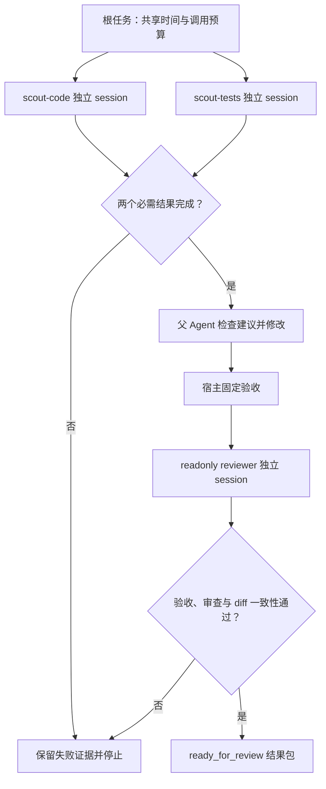

# Pi Agent实战：11子Agent协作与可审阅的结果包

本章配套项目：[projects/03-sdk-harness](../../projects/03-sdk-harness/README.md)。从课程目录进入这个项目，后面的命令都在项目根目录执行。同一项目的副本可以沿用，其他项目的依赖和副本要分别准备。

```bash
cd projects/03-sdk-harness
npm ci --ignore-scripts --cache .pi/npm-cache
```

运费修复里有两件事可以分头看：代码把边界写成了啥，公开业务约束又要求啥。让两个只读子 Agent 各看一边，结果回来后由父 Agent 修改，再交给固定检查和独立 reviewer。每个角色有自己的上下文，宿主负责把结果收齐。人手是多了，但交接工作可一点儿不能少，不然就成了四个人开会，一个 bug 还在旁边看热闹。

## 11.1 委派、执行与回收子 Agent

单次运行实现见 [sdk.ts](../../projects/03-sdk-harness/src/harness/sdk.ts)，父子 Agent 的各阶段如何衔接，见 [index.ts](../../projects/03-sdk-harness/src/harness/index.ts)。

### 什么值得交给子 Agent

算费用、查 JSON 字段，普通函数就干得挺好，没必要请模型来当计算器。同一上下文里顺手能搞定的事，也可以留给当前 Agent。需要换一份独立上下文去探查或审查，才值得创建子 Agent。多一个帮手，就多一份请求、等待和证据核对；有人交差，有人掉链子，父任务还得知道怎么接。

Pi 官方 subagent 扩展示例通过独立 Pi 子进程演示单次、并行和链式调用，同时管理 usage 与取消。本例改用 SDK 独立 session，保留结果回收、用量和取消管理，Agent 循环仍由 SDK 执行。细节可看官方文档：[官方 Subagent README](https://github.com/earendil-works/pi/blob/v1.4.0/packages/coding-agent/examples/extensions/subagent/README.md)

本例的各角色处于同一 Node 进程和同一受控目录。独立 session 分开对话与资源装配，独立进程还可以分开内存和生命周期，但两者都不能自动限制文件、网络与凭据访问。OS 执行边界需要第 13 章的隔离设计。细节可看官方文档：[Pi 安全边界](https://github.com/earendil-works/pi/blob/v1.4.0/packages/coding-agent/docs/security.md)

### 一次委派就是一个受约束的运行

给帮手派活，也得把工单填完整。`runAgent()` 接收角色、目标、显式 runtime、工作区和根控制器，交回的 `AgentResult` 带着 `agentId`、`parentTaskId`、session 引用、状态、答案、错误、耗时和 usage。失败的人也要交一份记录。至于子 Agent 提出的建议，父 Agent 收到后要当数据校验，不能自动升格为必须执行的指令。

一次 `run("scout-code", prompt)` 先创建 session，安装预算与路径 hook，订阅完成 usage，再调用 `prompt()`。运行结束后校验结果与文件行号，释放资源，最后交回结果。并发运行时，这些步骤仍各自完整执行。细节可看官方文档：[SDK Session 生命周期](https://github.com/earendil-works/pi/blob/v1.4.0/packages/coding-agent/docs/sdk.md)

子 Agent 只拿到 `read,grep,find,ls`，没有 write、edit、bash、再次委派或隐式扩展。输入只带当前目标和选定的结构化结果，不用把全部历史搬过去。帮手来查一个问题，没必要先读完团队自传。最终 JSON 必须落到真实文件证据，空证据、越界路径、无效行号和错误枚举都会让该运行失败。

### 增加最多两个只读并行任务

team 模式只有两个固定 scout：

```typescript
const scouts: AgentResult[] = await Promise.all([
  run("scout-code", "只探查实现和边界，提供文件证据"),
  run("scout-tests", "只核对公开业务约束与可见验证入口，真实覆盖列为未知"),
]);
```

两项任务在派发前已经确定，默认并发为 2，没有动态递归或并行写入。`runAgent()` 将已知运行失败转换为结果，`Promise.all` 因此可以收齐两名 scout 的状态。父 Agent 修改时需要这两份探查结果，少一份就先停在这里。

`HarnessTaskSpec.scoutConcurrency` 必须为 `1` 或 `2`，CLI 默认 2。端点容量有限时，传 `--scout-concurrency 1`，code scout 成功后才派发 tests scout。两者仍使用独立 session、共享根预算。遇到上游错误，程序不会擅自改成串行再试，更不会用新结果盖掉旧失败。

`retryTransient` 也必须显式为 boolean，CLI 的 `--retry-transient` 开启第 10 章介绍的 Pi 内建暂态重试。重试留在原 session 内，继续消耗根模型调用计数与同一截止时间，不会重新派发一批子任务。事件 `retry_scheduled` 和 `retry_finished` 记录恢复或耗尽；未被官方分类器识别的错误不会进入这条路径，例如裸 `upstream failed`。

写模式的固定调度如下；每个 Agent 节点是独立 session，整条链使用同一根预算。验证失败仍可交给 reviewer 诊断，但最终不能通过。



四个角色花的是同一笔根预算，也听同一个取消信号。一项任务把额度用完，其他在途运行也会被取消。usage 按角色记，再求和，免得父 Agent 的账单看着很节俭，子 Agent 的消费却都藏在桌子底下。官方示例见 [Subagent 源码](https://github.com/earendil-works/pi/blob/v1.4.0/packages/coding-agent/examples/extensions/subagent/index.ts)。

`scout-tests` 只能看到副本中的源码、TASK、AGENTS 和 package.json。路径护栏拒绝读取工作区外的验收实现，因此它能核对的只有公开约束和看得见的 npm test 入口，真实测试覆盖了什么，必须留在 unknowns 里。固定验收仍由宿主执行。

### 跑通探查、修改、验收、审查

写模式需要已验证的 provider/model 与环境凭据，自定义 endpoint 同时传入 `--models`。下面从本章项目根目录创建新的可信练习副本；`--allow-write` 只能与 team 一起使用，程序要求真实路径位于 `.pi/labs/` 下且带课程 marker。已有同名副本时另选名称并同步 workspace，保留旧现场：

```bash
npm run lab:init -- --name shipping-team
npm run example -- \
  --workspace .pi/labs/shipping-team \
  --provider YOUR_PROVIDER --model YOUR_MODEL \
  --mode team --allow-write --timeout-ms 300000 --max-model-calls 24 \
  --goal "修复国内订单恰好5000分的免基础运费边界；国内低于5000分基础费500，国际基础费2000，加急额外800；只改src/shipping.ts"
```

`--allow-write` 为父 Agent 开放修改权限，路径护栏将写入限制在现有 `src/shipping.ts`。真实路径与课程 marker 用于防止误改普通项目，不能隔离恶意代码。

运行后应依次看到 scout、root、固定验收和 reviewer。程序没有自动修复循环，失败后保留 diff 与报告，下一次任务据此决定是否还需修改。固定验收与审查版本的检查方式见第 11.2 节。

### 按失败阶段决定下一步

scout 失败时，先检查对应 session。最终 JSON 不合契约，就检查输出；用正则捞出“成功”两个字，可补不齐缺失的字段。证据不够，就缩小目标或说明需要哪些文件。上游错误可以在预算内重试，但先看清有没有已经写下的改动。

已有真实运行出现过两种现场：code scout 完成后，tests scout 遇到服务错误，任务停在父写之前；另一次则已经完成父修改并通过固定验收，reviewer 才耗尽重试。前者尚无补丁，后者已有修改，下一次任务可能只需补验证或审查。并行与串行都曾出现上游错误，不能将其简单归因于并发。逐次输出和完整成功运行见 [真实验证记录](../reference/validation.md)。

写模式各必需阶段通过后，终态才是 `ready_for_review`。只读 team 不执行修复验收，正常终态为 `analysis_complete`，reviewer 指出缺陷仍可算作有效分析结果。

这套调度要用正常 team、必需子失败、父取消、预算不足和证据不足分别验证。`npm test` 覆盖结构与决策规则，真实请求和停止行为则单独运行：取消后查看 session 是否全部释放、usage 是否收齐父子运行，并核对子任务的工具，确认没有写入或递归委派能力。再将 single 与 team 的只读分析并列，比较结论、耗时、调用与未知费用，判断独立探查带来的收益是否值得这些成本。

## 11.2 整理可审阅的结果包

补丁写完，下一位审阅者可未必陪你盯过终端。结果包得让他不用补看整段聊天，就能知道改了什么、为什么改、起点是什么、实际跑过哪些检查、哪个必需步骤没做成。reviewer 没完成，也得明明白白摆出来，别把这个关键信息埋进几百行对话里。

[index.ts](../../projects/03-sdk-harness/src/harness/index.ts) 汇总运行并生成报告，[validation.ts](../../projects/03-sdk-harness/src/harness/validation.ts) 提供固定验收，模型说明与宿主检查由此分别进入结果包。

### 将模型说明与执行证据放在一起

报告里的“测试通过”得找得到执行记录，“审查完成”得对得上 reviewer 的结果。只看过测试文件，就写看过，别顺手帮测试跑完了。子任务失败也照样留下，父 Agent 总结得再漂亮，也替不了那个没完成的步骤。

Pi 提供消息、工具结果、session、usage 和完成消息的 stopReason。宿主将它们与固定验收组成 `TaskReport`，再用纯函数判断终态。模型解释修复理由，执行记录支持是否完成的结论。细节可看官方文档：[Message Types](https://github.com/earendil-works/pi/blob/v1.4.0/packages/coding-agent/docs/message-types.md)

### 产物要保留来源和比较口径

每次运行独占创建 `.pi/runs/<taskId>/`，同名目录不允许覆盖。成功包和失败包各留一份，报告里的引用也就有了明确去处：

| 产物 | 审阅时要回答的问题 |
|---|---|
| `report.json` | 状态、目标、配置、Agent 结果、验证和限制是否完整 |
| `report.md` | 人能否快速看清结果、失败与未知项 |
| `baseline.diff` | 开始前是否已经存在修改 |
| `final.diff` | 结束时相对相同 Git index 的差异是什么 |
| `events.jsonl` | 派发、工具准入、验证与收尾的顺序是否合理 |
| `sessions/*.jsonl` | 每个结论能否回到具体 session 和消息 |

`baseline.diff` 和 `final.diff` 都相对同一 Git index 比较。课程 lab 通过 `git init`、`git add` 建立 index 基线，不创建 commit；取 diff 使用 `git --no-pager diff --no-ext-diff --no-textconv --binary`，避开仓库配置的外部 diff 与 textconv。开始时已经存在的修改仍可能出现在 final 中，baseline 因此必须一同交付，才能区分原始现场与本次改动。

Git diff 不包含未跟踪文件。本例只允许修改已经在 index 中的 `src/shipping.ts`，差异口径因而能覆盖受控写入；扩展到任意文件创建时，就要把 untracked 状态与新增内容也收进结果包，并相应调整验收定义。

session 保留分支、系统与工具变化等历史，发生争议时能查到最后一段文字之前的过程。细节可看官方文档：[Session Format](https://github.com/earendil-works/pi/blob/v1.4.0/packages/coding-agent/docs/session-format.md) 完整历史也可能包含敏感文件内容、路径和参数，因此只在受控目录保存；对外分享前必须检查和处理这些数据，不能默认上传完整 session。

### 用固定脚本验证真实行为

父 Agent 没有通用 bash。写阶段完成后，由 CLI 中的 `verifyShippingWorkspace()` 调用固定检查。下面展示的是宿主调用形式，目标 `shipping-report` 副本将在下一节创建：

```bash
node --import tsx scripts/check_lab.ts --workspace .pi/labs/shipping-report
```

实际调用用真实绝对路径，并把参数通过 `execFile` 数组传递，模型写的文字不会被当成 shell 命令执行。stdout JSON 的 `passed:true` 与退出码 0 必须同时成立，二者共同进入 `ValidationResult`，连同输出、命令和状态保存。超时、取消、JSON 损坏、脚本不存在与检查失败分别留下诊断，避免将“没有拿到报告”写成测试通过。

报告中的 `shipping-contract` 检查运费行为：国内订单小于 5000 分收基础费 500，恰好及高于 5000 分免基础费；国际基础费 2000，加急另加 800。检查关心的是运费算得对不对，补丁不必长得一模一样。脚本与测试由课程 fixture 提供，模型不能修改它们来降低标准。

还有一种容易漏掉的错位：reviewer 审的是一份补丁，交出去的却是后来又改过的版本。这里在审查前存下待审 diff，收尾用 `reviewed-diff-stability` 对照最终 diff，不一致就判验收失败。它只负责比较这两份 diff，运费行为仍靠前面的固定检查。文件系统并没有上锁，审查时别另开写进程；OS 隔离和完整的外部修改检测也不由它提供。

### 从完整 CLI 入口收集结果

以下命令从本章项目根目录执行，需要已验证的 provider/model 与环境凭据。替换占位标识，自定义端点加 `--models`；同名副本存在时另取名称并同步后续 workspace。第一轮 `lab:check` 在已知缺陷上应失败，随后再执行 team 写模式：

```bash
npm run lab:init -- --name shipping-report
npm run lab:check -- --workspace .pi/labs/shipping-report
npm run example -- \
  --workspace .pi/labs/shipping-report \
  --provider YOUR_PROVIDER --model YOUR_MODEL \
  --mode team --allow-write --timeout-ms 300000 --max-model-calls 24 \
  --goal "修复国内订单恰好5000分免基础运费的边界；保留国际基础费2000与加急加800规则，只修改src/shipping.ts"
npm run lab:check -- --workspace .pi/labs/shipping-report
```

第一轮检查留下缺陷起点，最后一轮检查则反映当前工作区是否真的修好，失败也应原样保存。最终 stdout 的 `artifacts.report` 指向本次 taskId 的报告，复现结果以这份报告和实际终端输出为准。

`report.json` 应包含 root 和三个子角色，各有独立 sessionId，并以 `parentTaskId` 关联根任务。写模式要求四个 `AgentResult` 均为 `completed`、两项固定检查通过、reviewer verdict 为 `acceptable`，才写入 `ready_for_review`。该状态表示补丁可供审阅，尚未执行 commit、push、合并或发布。细节可看官方文档：[SDK 会话与统计接口](https://github.com/earendil-works/pi/blob/v1.4.0/packages/coding-agent/docs/sdk.md)

报告的 `usage` 将 token 与 SDK 已报告费用分别保存。价格未核实时，`costEstimateAvailable:false`、`estimatedCostUsd:null`，即使 `reportedCostUsd:0` 也不能推断真实账单为零。`durationMs` 从 `runHarness()` 开始计到报告对象构造时，包含协调和最终 diff 核对，不含随后保存报告的时间。scout 可以重叠运行，因此它不等于四个 Agent 耗时相加。

### 失败包也要保留已发生的工作

一个 scout 失败时，接手者需要知道它是谁、父写是否开始、已有 usage 是多少，才能决定下一步。固定验证失败就记为 failed，即使 root 和 reviewer 都赞同补丁，这个失败结果也得保留。两票赞成，不能把没过的测试表决通过。取消不会回滚已发生的修改，取消包要留下已有 diff 和中间证据，供后续核验；若进程被强杀，最终报告来不及生成，就按第 10 章盘点，并记录这次运行未正常收尾。

类型检查、契约测试、SDK self-check、真实模型请求和固定验收各占一项记录，各自说明验证了什么，已有记录见 [validation.md](../reference/validation.md)。整项任务的结论要等必需项收齐后再定。

成功包和失败包放在一起看，能不能接手就更清楚了。修改理由、起始现场、实际验证、子 Agent 状态和 unknowns，都应沿着文件证据查得到。摘要有时会漏掉较晚完成的子任务，最终判断还是要回到完整结果，别让最后交卷的那位连失败记录都没赶上入册。实在找不到证据，就留作未知。

结果包整理后，在本地执行 `npm run typecheck`、`npm test` 与 `npm run build`，等必需验证完成后再写成功结论。报告保存在本地，提交或外发仍需另外执行。

## 参考资料

- [Subagent 扩展示例说明，v1.4.0](https://github.com/earendil-works/pi/blob/v1.4.0/packages/coding-agent/examples/extensions/subagent/README.md)
- [Subagent 扩展示例源码，v1.4.0](https://github.com/earendil-works/pi/blob/v1.4.0/packages/coding-agent/examples/extensions/subagent/index.ts)
- [SDK，v1.4.0](https://github.com/earendil-works/pi/blob/v1.4.0/packages/coding-agent/docs/sdk.md)
- [Security，v1.4.0](https://github.com/earendil-works/pi/blob/v1.4.0/packages/coding-agent/docs/security.md)
- [Message Types，v1.4.0](https://github.com/earendil-works/pi/blob/v1.4.0/packages/coding-agent/docs/message-types.md)
- [Session File Format，v1.4.0](https://github.com/earendil-works/pi/blob/v1.4.0/packages/coding-agent/docs/session-format.md)
- [Sessions：导出与分享，v1.4.0](https://github.com/earendil-works/pi/blob/v1.4.0/packages/coding-agent/docs/sessions.md)
